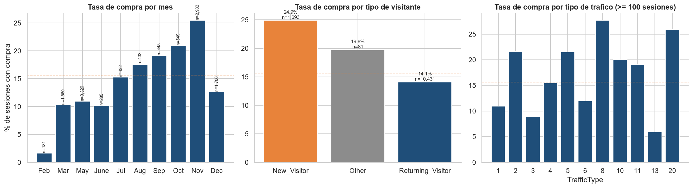
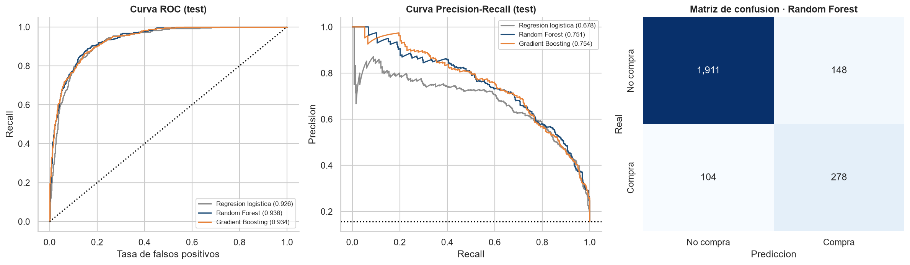
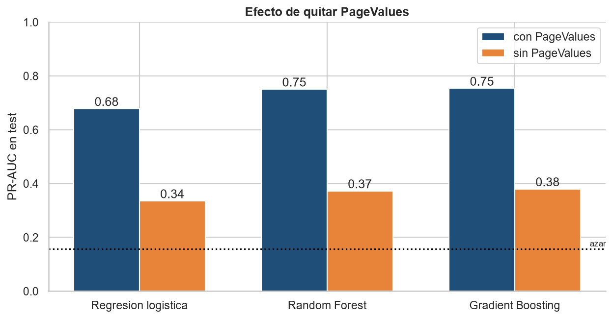
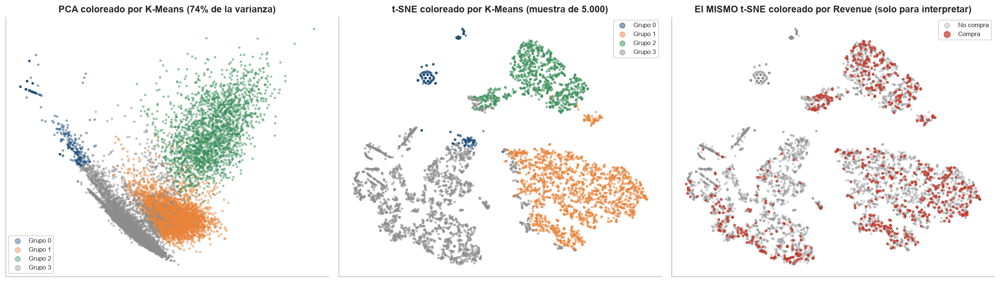
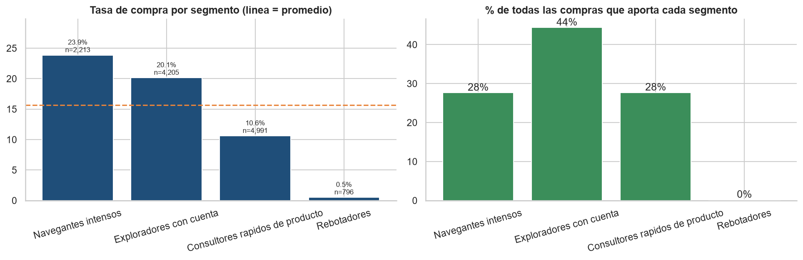
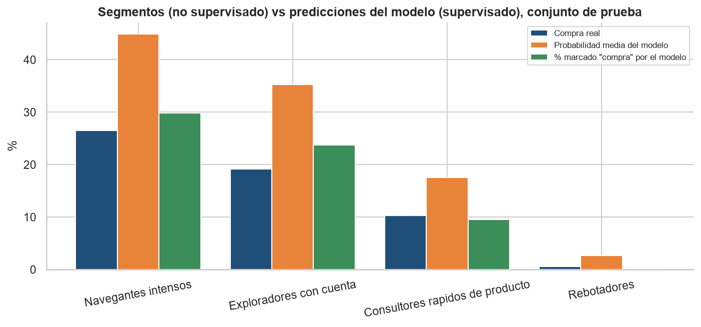

# Evaluación 4 — Predicción de intención de compra y segmentación de visitantes

**Grupo 3 · Análisis de Datos · ITM 2026-2 · Docente: Daniel Alexis Nieto Mora**

| Integrante | Usuario de GitHub |
|---|---|
| Santiago Betancur | [@Xantyagoh](https://github.com/Xantyagoh) |
| Diego Alzate | [@DiegoA1123](https://github.com/DiegoA1123) |
| Carlos Mendez | [@carmarisx](https://github.com/carmarisx) |
| Sebastian Cadavid | [@Exmen9](https://github.com/Exmen9) |
| Daniel Martinez | [@danielmmnez](https://github.com/danielmmnez) |

---

## Descripción del problema

Un comercio electrónico registra miles de **sesiones de navegación** (páginas vistas, tiempo, tasa de rebote, procedencia del tráfico…) y solo una pequeña parte termina en compra. Este proyecto aborda dos preguntas complementarias con el mismo conjunto de datos:

| Componente | Pregunta | Tipo de aprendizaje |
|---|---|---|
| **Supervisado** | Dada una sesión, ¿**terminará en compra**? (variable objetivo `Revenue`) | Clasificación binaria con desbalance (15,6 % de compras) |
| **No supervisado** | ¿Qué **tipos de visitantes** existen según su forma de navegar? (sin usar `Revenue`) | Agrupamiento (segmentación) |

**Preguntas que guían el análisis**
1. ¿Qué tan desbalanceada está la compra y cómo afecta la elección de métricas?
2. ¿Qué características de la sesión se relacionan con comprar?
3. ¿Qué tan bien se puede predecir la compra y cuánto depende de una sola variable (`PageValues`)?
4. ¿Existen segmentos de visitantes con comportamientos claramente distintos?
5. ¿Los segmentos descubiertos *sin etiquetas* coinciden con quienes compran?
6. ¿Qué enfoque recomendaríamos para una aplicación real?

## Fuente de datos

**Online Shoppers Purchasing Intention Dataset** — UCI Machine Learning Repository (id 468)
- Enlace: https://archive.ics.uci.edu/dataset/468/online+shoppers+purchasing+intention+dataset
- Cita: Sakar, C. & Kastro, Y. (2018). *Online Shoppers Purchasing Intention Dataset*. UCI Machine Learning Repository. https://doi.org/10.24432/C5F88Q · Licencia CC BY 4.0
- Artículo asociado: Sakar, C. O., Polat, S. O., Katircioglu, M., & Kastro, Y. (2019). Real-time prediction of online shoppers' purchasing intention using multilayer perceptron and LSTM recurrent neural networks. *Neural Computing and Applications*, 31, 6893–6908.
- 12.330 sesiones (12.205 sin duplicados) · 17 variables + `Revenue`. El archivo está incluido en [`data/`](data/); detalle en [`data/README.md`](data/README.md).

## Estructura del proyecto

```
evaluacion 4/
├── README.md
├── requirements.txt
├── data/
│   ├── online_shoppers_intention.csv     datos originales (1 MB)
│   └── README.md                         ficha y diccionario de datos
├── src/
│   └── preprocesamiento.py               division train/test y preprocesador sin fuga de informacion
├── notebooks/
│   ├── 01_problema_y_eda.ipynb           problema, calidad de datos y EDA
│   ├── 02_preprocesamiento.ipynb         decisiones, pipeline anti-fuga, seleccion de variables y PCA
│   ├── 03_supervisado.ipynb              regresion logistica, Random Forest, Gradient Boosting
│   ├── 04_no_supervisado.ipynb           K-Means, Gaussian Mixture, Aglomerativo, PCA/t-SNE, perfiles
│   └── 05_comparacion_y_conclusiones.ipynb   8 preguntas comparativas y recomendacion
├── figuras/                              graficos generados por los notebooks
├── resultados/                           metricas y segmentos (CSV/JSON)
└── docs/
    └── decisiones_tecnicas.md            decisiones tecnicas, metricas y resultados
```

## Instrucciones de ejecución

```bash
git clone https://github.com/Xantyagoh/grupo3-ml-intencion-compra.git
cd grupo3-ml-intencion-compra
python -m venv venv
venv\Scripts\activate                     # Mac/Linux: source venv/bin/activate
pip install -r "evaluacion 4/requirements.txt"
cd "evaluacion 4/notebooks"
jupyter notebook                          # ejecutar 01, 02, 03, 04 y 05 en orden (Restart & Run All)
```

- Los notebooks **03 y 04 generan** los archivos de `resultados/` que lee el **05**: ejecutarlos antes.
- El notebook 03 tarda ~3–4 minutos (búsqueda de hiperparámetros); el resto, menos de un minuto cada uno.
- Todas las semillas están fijadas (`SEMILLA = 42`), así que los resultados son reproducibles.

## Principales resultados

### Hallazgos del análisis exploratorio
- **Desbalance:** solo el **15,6 %** de las sesiones termina en compra (5,4 sesiones sin compra por cada compra). Un modelo que siempre dice "no compra" tendría 84,4 % de accuracy y no detectaría nada.
- **Estacionalidad:** la tasa de compra va de 1,7 % en febrero a **25,5 % en noviembre**.
- **Visitantes nuevos compran más** (24,9 %) **que los recurrentes** (14,1 %).
- **`PageValues`** separa casi todo (56,3 % de compra cuando es > 0 frente a 3,9 % cuando es 0) pero se calcula con información del resultado: **riesgo de fuga de información**.



### Componente supervisado: ¿esta sesión terminará en compra?
Tres modelos comparados con validación cruzada estratificada de 5 pliegues, ajuste de hiperparámetros, umbral elegido solo con train y evaluación final una sola vez en test (2.441 sesiones, 382 compras).

| Modelo | Precision | Recall | F1 | ROC-AUC | PR-AUC |
|---|---|---|---|---|---|
| Regresión logística | 0,602 | 0,764 | 0,674 | 0,926 | 0,678 |
| **Random Forest (elegido)** | 0,653 | 0,728 | 0,688 | 0,936 | 0,751 |
| Gradient Boosting | 0,643 | 0,736 | 0,686 | 0,934 | 0,754 |

- El **Random Forest detecta 278 de 382 compras** (72,8 %) con 65,3 % de precisión; **PR-AUC 0,751, 4,8 veces el azar** (0,156). El modelo se eligió por PR-AUC fuera de muestra en train, no por test.
- **Los modelos de árboles superan a la regresión logística** (+0,07 de PR-AUC): hay no linealidades.
- ⚠️ **`PageValues` explica más de la mitad del desempeño:** sin ella la PR-AUC baja a **0,37** (2,4 veces el azar). El modelo es útil *si* esa variable está disponible antes de la compra.




### Componente no supervisado: ¿qué tipos de visitantes hay?
K-Means, Gaussian Mixture y Aglomerativo sobre 8 variables de navegación (sin `Revenue` ni `PageValues`), con k = 4 (Davies-Bouldin mínimo y Calinski-Harabasz máximo).

| Algoritmo | Silhouette | Davies-Bouldin | Calinski-Harabasz |
|---|---|---|---|
| **K-Means** | **0,409** | 0,850 | **9.436** |
| Gaussian Mixture | 0,377 | 0,865 | 7.923 |
| Aglomerativo (Ward) | 0,395 | **0,836** | 8.521 |

Los tres algoritmos coinciden (ARI entre 0,79 y 0,91) y los grupos son muy estables (ARI 0,997 con submuestras). Segmentos de K-Means:

| Segmento | % de sesiones | Tasa de compra | % de las compras |
|---|---|---|---|
| Navegantes intensos | 18 % | 23,9 % | 28 % |
| Exploradores con cuenta | 34 % | 20,1 % | **44 %** |
| Consultores rápidos de producto | 41 % | 10,6 % | 28 % |
| Rebotadores | 7 % | 0,5 % | 0,2 % |




### Comparación entre enfoques
Los segmentos descubiertos **sin etiquetas** ordenan a los visitantes igual que el modelo supervisado (mayor probabilidad de compra en los *Navegantes intensos*, casi cero en los *Rebotadores*), aunque como partición **no coinciden** con "compra / no compra" (ARI = 0,011). El no supervisado dice *cómo* navegan; el supervisado, *si* comprarán: son complementarios. Las respuestas a las 8 preguntas del enunciado están en [`notebooks/05_comparacion_y_conclusiones.ipynb`](notebooks/05_comparacion_y_conclusiones.ipynb) y las decisiones técnicas en [`docs/decisiones_tecnicas.md`](docs/decisiones_tecnicas.md).



## Conclusiones y recomendaciones

1. **La compra se puede anticipar, pero con una dependencia crítica:** con `PageValues` el modelo logra F1 ≈ 0,69 y PR-AUC 0,75; sin ella, PR-AUC 0,37. Antes de usarlo en producción hay que confirmar **cuándo se calcula** esa variable.
2. **Hay 4 tipos de visitantes, estables y con perfiles claros.** Los *Exploradores con cuenta* aportan el 44 % de las compras y los *Rebotadores* casi ninguna.
3. **Recomendación:** usar **los dos enfoques**: el modelo supervisado (con umbral bajo, porque la falsa alarma es barata) para actuar sobre sesiones concretas, y la segmentación K-Means para diseñar estrategias y presupuesto por tipo de visitante.
4. **Estrategias:** asistencia en vivo para *Navegantes intensos*; recordatorios para *Exploradores con cuenta*; reducción de fricción para *Consultores rápidos*; mejorar la página de entrada y la calidad del tráfico para los *Rebotadores*; concentrar campañas en octubre–noviembre.
5. **Limitaciones:** un solo comercio y un año de datos; probabilidades no calibradas; costos de error supuestos; solo 382 compras en test (intervalos amplios); el agrupamiento depende de decisiones del analista.

## Video de presentación

Enlace al video: https://youtu.be/gupoVuuAxYQ

## Referencias

- Sakar, C. & Kastro, Y. (2018). *Online Shoppers Purchasing Intention Dataset* [Dataset]. UCI Machine Learning Repository. https://doi.org/10.24432/C5F88Q
- Sakar, C. O., Polat, S. O., Katircioglu, M., & Kastro, Y. (2019). Real-time prediction of online shoppers' purchasing intention using multilayer perceptron and LSTM recurrent neural networks. *Neural Computing and Applications*, 31, 6893–6908.
